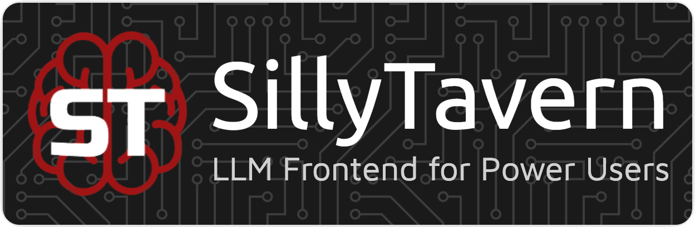

# My SillyTavern Settings:
This repository contains my **SillyTavern** settings, presets, guides and regex.
For more info and help, feel free to contact me at my [reddit](https://www.reddit.com/user/ashuotaku/) or [dicord](https://discord.com/users/1069149872483225630): @ashuotaku

> [!IMPORTANT]
> ### Key information:
> To use presets like Eva and Neko, which come with [noass](https://gitgud.io/Monblant/noass) settings, please install the [noass](https://gitgud.io/Monblant/noass) extension in your sillytavern, then only it will work and after installing the extension import the settings of noass extenstion into it.

## All presets:
- [Eva](<ChatCompletionPresets/Eva (Deepseek)/>) - Especially for Deepseek v4 Flash and Pro, and Deepseek v3.2
### Old:
- [Neko](<ChatCompletionPresets/Neko (Gemini)/>) - Especially for Gemini 3+ Pro and Flash
- [Gemini](ChatCompletionPresets/Gemini/) - Outdated
- [Deepseek](<ChatCompletionPresets/Deepseek V3 0324 (free)/>) - Outdates

## Guides & Others:
- [Scrapping character cards details from janitor ai using nodejs and cloudflare.](Guides/JanitorAI_Scrapper.md)
- [JanitorAi Google Colab Script](Scripts/JanitorAI/janitor_scrapper_v2.ipynb)

> [!TIP]
> You can buy me a coffee to support me in my work: [@ashuotaku](https://www.buymeacoffee.com/ashuotaku)
>
> 